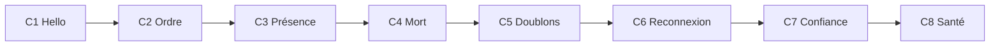

# Le chat de Dousville (spirale individuelle)

Chaque étudiant construit **son** chat, dans **le langage de son choix**, en 8 étapes guidées. À chaque thématique du module, le chat reçoit **une** amélioration qui met en pratique le thème du jour. Il sert aussi de banc d'essai avant de construire les services de la ville ([fil rouge](../fil-rouge/README.md)).

| Étape | Thématique | Le chat apprend à… | Drill préalable | Fallacy | Théorie |
|---|---|---|---|---|---|
| [C1](C1-hello.md) | [Sérialisation](../../thematiques/01-serialisation.md) | envoyer et recevoir des messages valides | [D01](../drills/D01-serialisation.md) | 3, 8 | [Sérialisation](../../supports/Sérialisation.md) |
| [C2](C2-ordre.md) | [Temps](../../thematiques/02-temps.md) | afficher dans le bon ordre | [D02](../drills/D02-temps.md) | heure | [NTP](../../supports/ntp.md) |
| [C3](C3-presence.md) | [MQTT](../../thematiques/03-mqtt.md) | savoir qui est là, parler en privé | [D03](../drills/D03-qos-retain.md) | 1, 2 | [MQTT](../../supports/mqtt.md) |
| [C4](C4-mort.md) | [Microservices](../../thematiques/04-microservices.md) | annoncer sa propre mort | [D04](../drills/D04-mort-noeud.md) | 1, 5 | [MQTT](../../supports/mqtt.md#last-will-and-testament-lwt) |
| [C5](C5-doublons.md) | [Idempotence](../../thematiques/05-idempotence.md) | ignorer les doublons | [D05](../drills/D05-idempotence.md) | 1 | [Idempotence](../../supports/idempotence.md) |
| [C6](C6-reconnexion.md) | [Résilience](../../thematiques/07-resilience.md) | survivre à la coupure du broker | [D07](../drills/D07-retry.md) | 1, 2 | [Design for failure](../../supports/design4failure.md) |
| [C7](C7-confiance.md) | [Sécurité](../../thematiques/09-securite.md) | prouver l'auteur, refuser le rejeu | [D09](../drills/D09-securite.md) | 4, 6 | [Sécurité](../../supports/securite.md) |
| [C8](C8-sante.md) | [Supervision](../../thematiques/10-supervision.md) | dire comment il va, sobrement | [D10](../drills/D10-monitoring-energie.md) | 7 | [Puissance et énergie](../../supports/Puissance%20et%20énergie.md) |

## Règles du jeu

- **Individuel**, un dossier par étudiant (`chat-<prénom>`), un `git commit` par étape terminée.
- **Langage libre.** Contrainte : une bibliothèque MQTT mature (client MQTT 3.1.1 au minimum). Vous justifiez votre choix en C1.
- **IA autorisée si vous comprenez.** Chaque étape se termine par une rubrique *Terminé quand* : on vous demandera de l'expliquer, voir [évaluation](../../evaluation/umdd-v2.md).
- **Le contrat fait foi** : [activites/contrats](../contrats/README.md). Vous n'inventez ni topics ni champs sans le faire amender.
- **Les outils de vérification sont dans le labo** : [infra](../infra/README.md). `DC` = `docker compose exec broker` (à lancer depuis `activites/infra`).
- **Un `NOTES.md` à la racine de votre dossier** : 2 lignes par étape (« ce que j'ai compris », « ce qui a cassé »). Il servira de base à l'oral.

## Après la spirale

Le chat est la base de plomberie (connexion, enveloppe, validation, reconnexion, signature) que vous **réutiliserez** pour les services Dousville de votre groupe.
