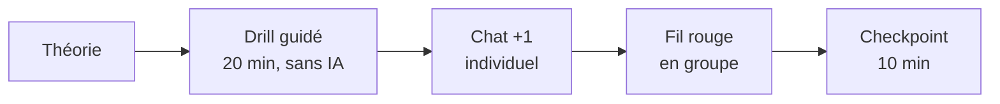

# Planning (suggestion)

> **Ce document est la seule place où les séquences existent.** Les [thématiques](../thematiques/README.md) sont indépendantes de l'ordre et du découpage ci-dessous : réordonnez, fusionnez ou sautez selon la classe.

**40 périodes ≈ 8 semaines à 5 périodes** → 8 séquences, dont **une réservée à l'évaluation**.

## Rythme de chaque séquence de contenu

## Vue d'ensemble

| Séq. | Thématiques                                                                                        | Drills   | Chat   | Fil rouge (UMDD)                                                                                       | Checkpoint |
|------|----------------------------------------------------------------------------------------------------|----------|--------|--------------------------------------------------------------------------------------------------------|------------|
| 1    | [Sérialisation](../thematiques/01-serialisation.md) (+ mise en route)                              | D01      | C1     | [Vitrine](../activites/fil-rouge/umdd/vitrine.md)                                                      |            |
| 2    | [Temps](../thematiques/02-temps.md), [MQTT](../thematiques/03-mqtt.md)                             | D02, D03 | C2, C3 | [TimeService](../activites/fil-rouge/umdd/time.md)                                                     | oui        |
| 3    | [Microservices](../thematiques/04-microservices.md)                                                | D04      | C4     | [Log et annuaire](../activites/fil-rouge/umdd/log-annuaire.md)                                         | oui        |
| 4    | [Idempotence](../thematiques/05-idempotence.md), [Transactions](../thematiques/06-transactions.md) | D05, D06 | C5     | [Banque et coopérative](../activites/fil-rouge/umdd/banque-coop.md)                                    | oui        |
| 5    | [Résilience](../thematiques/07-resilience.md), [Cluster et P2P](../thematiques/08-cluster-p2p.md)  | D07, D08 | C6     | [Annuaire en cluster](../activites/fil-rouge/umdd/cluster.md)                                          | oui        |
| 6    | [Sécurité](../thematiques/09-securite.md)                                                          | D09      | C7     | [Sécurité](../activites/fil-rouge/umdd/securite.md)                                                    | oui        |
| 7    | [Supervision](../thematiques/10-supervision.md), [Énergie](../thematiques/11-energie.md) + défi    | D10      | C8     | [Supervision](../activites/fil-rouge/umdd/supervision.md), [Défi](../activites/fil-rouge/umdd/defi.md) | oui        |
| 8    | **Évaluation**                                                                                     |          |        | la ville telle que laissée en séquence 7                                                               |            |

## Détail suggéré

### Séquence 1
| P   | Contenu                                                                                                                                                                                                                                                                             |
|-----|-------------------------------------------------------------------------------------------------------------------------------------------------------------------------------------------------------------------------------------------------------------------------------------|
| 1   | Mise en route : présenter le parcours et l'[évaluation](../evaluation/umdd-v2.md), lire l'[histoire de départ](../UMDD.md) (quelle fallacy derrière chaque promesse ?), installer le [labo](../activites/infra/README.md), choisir le [fil rouge](../activites/fil-rouge/README.md) |
| 2   | Théorie sérialisation + D01                                                                                                                                                                                                                                                         |
| 3–4 | C1                                                                                                                                                                                                                                                                                  |
| 5   | Fil rouge : vitrine                                                                                                                                                                                                                                                                 |

### Séquence 2
| P   | Contenu                              |
|-----|--------------------------------------|
| 1   | Théorie NTP + D02                    |
| 2   | Théorie MQTT + D03                   |
| 3   | C2, C3                               |
| 4–5 | Fil rouge : TimeService ; checkpoint |

### Séquence 3
| P   | Contenu                                                       |
|-----|---------------------------------------------------------------|
| 1   | Théorie microservices + D04                                   |
| 2   | C4                                                            |
| 3   | Atelier contrats : la classe écrit l'annuaire en pull request |
| 4–5 | Fil rouge : Log + annuaire ; checkpoint                       |

### Séquence 4
| P   | Contenu                                                  |
|-----|----------------------------------------------------------|
| 1   | Théorie idempotence + D05                                |
| 2   | Théorie transactions + D06                               |
| 3   | C5 + atelier contrats banque et coopérative              |
| 4–5 | Fil rouge : banque, coopérative, Fair Trade ; checkpoint |

### Séquence 5
| P   | Contenu                                                          |
|-----|------------------------------------------------------------------|
| 1   | Théorie design for failure + D07                                 |
| 2   | Théorie cluster / P2P + D08                                      |
| 3   | C6                                                               |
| 4–5 | Fil rouge : cluster, pannes provoquées avec le labo ; checkpoint |

### Séquence 6
| P   | Contenu                                                |
|-----|--------------------------------------------------------|
| 1   | Théorie confidentialité + réseau de confiance          |
| 2   | D09                                                    |
| 3   | C7 : atelier d'amendement du contrat `v: 2`, puis code |
| 4–5 | Fil rouge : sécuriser les services ; checkpoint        |

### Séquence 7
| P | Contenu |
|---|---|
| 1 | Théorie monitoring + D10 (parties 1 et 2) |
| 2 | Théorie énergie + D10 (partie 3) + C8 |
| 3 | Fil rouge : supervision ; checkpoint |
| 4 | **Vote du défi** parmi trois propositions, page « fallacies en jeu » |
| 5 | Réalisation du [défi](../activites/fil-rouge/umdd/defi.md), l'enseignant joue le provocateur avec le labo |

### Séquence 8 : évaluation

La ville de la séquence 7 sert de terrain. Deux pistes, attribuées ou tirées par l'enseignant (voir [évaluation](../evaluation/umdd-v2.md)) :

| Piste       | L'élève reçoit                       | Il doit                                                                                                                                    |
|-------------|--------------------------------------|--------------------------------------------------------------------------------------------------------------------------------------------|
| **Feature** | une *user story* sur la ville        | écrire le prompt (concepts, fallacy, comportement en panne, test d'acceptation), exécuter le résultat, expliquer un passage tiré au hasard |
| **Code**    | un code défectueux lié à une fallacy | expliquer le défaut, la fallacy et le scénario de panne, puis corriger                                                                     |

| P   | Contenu                                                                         |
|-----|---------------------------------------------------------------------------------|
| 1   | Cadrage (règles, IA permise, historique des prompts exporté), tirage des pistes |
| 2–3 | Épreuve individuelle                                                            |
| 4–5 | Défenses orales (≈ 3 min par élève) et débrief                                  |
|     |                                                                                 |

**À préparer avant la séquence 8 :**
- une banque d'énoncés et de codes défectueux couvrant les fallacies ([suggestions](../evaluation/umdd-v2.md#banque-dénoncés));
- des codes défectueux dans plusieurs langages (l'élève choisit celui qu'il lit le mieux) ;
- la ville de référence et le labo, prêts à être cassés.

## Si le temps manque

| Priorité | Sujet | Comment alléger |
|---|---|---|
| 1 | Idempotence + Transactions | ne jamais sauter, c'est le cœur de l'évaluation |
| 2 | Résilience | garder D07 et C6 |
| 3 | Cluster et P2P | ne garder que D08 |
| 4 | Énergie | D10 partie 3 seulement |
| 5 | Défi | le remplacer par une étape de plus au fil rouge |
