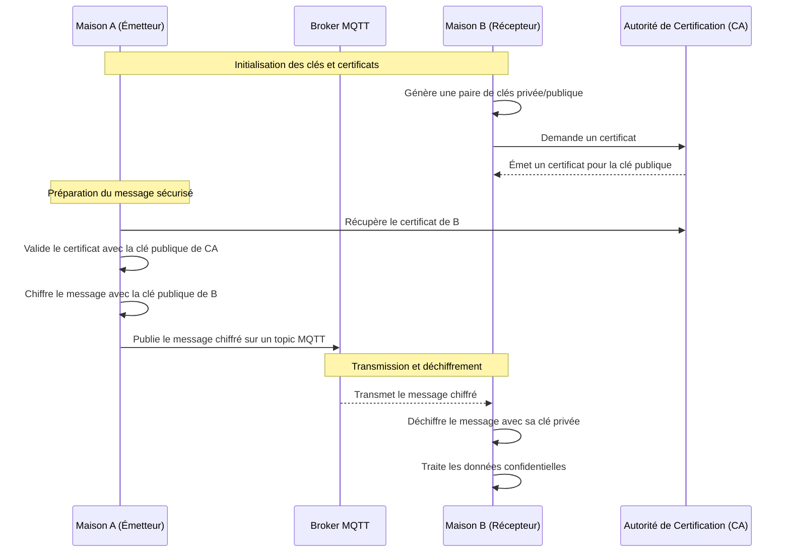

# Confidentialité

> **Fallacy :** 4 (le réseau est sûr).  
> **À retenir :** chiffrer protège la **lecture**, pas l'**auteur** ni le **rejeu**. Même le broker est un intermédiaire à qui on ne fait pas confiance.

La **confidentialité** garantit que seules les entités autorisées accèdent aux données échangées : pas d'interception ni de divulgation non autorisée.

## Principes clés

1. **Chiffrement des données** avant transmission : le contenu est illisible pour toute entité sans la clé de déchiffrement.
   - **Symétrique** : une seule clé chiffre et déchiffre.
   - **Asymétrique** : une paire de clés publique/privée.
2. **Authentification des parties** : les participants prouvent qu'ils sont autorisés à échanger.
3. **Protection en transit** : les données restent confidentielles pendant le transfert, même si le réseau est compromis.

Vocabulaire : [Sécurité](securite.md).

## Exemple avec des clés asymétriques

**Contexte.** La maison A envoie à la maison B, via un broker MQTT, des données de consommation confidentielles. On chiffre avec la clé publique de B.

1. A récupère la clé publique de B (et vérifie son certificat).
2. A chiffre le message avec la clé publique de B.
3. A s'authentifie au broker et publie le message chiffré.
4. Le broker transmet le message à B, sans pouvoir le lire.
5. B s'authentifie au broker et déchiffre avec sa clé privée.

Le certificat de B (délivré par la CA) permet à A de s'assurer qu'il envoie à la bonne entité. Seul B, grâce à sa clé privée, peut lire le message ; le broker relaie sans accéder au contenu.

## Avec clé symétrique

Même principe, mais il faut **se mettre d'accord sur la clé**, et si celle-ci est compromise, tout le réseau l'est !

En pratique on combine les deux : une cryptographie asymétrique pour échanger une clé symétrique, puis le chiffrement symétrique (plus rapide) pour les données.

## Limites

- Le chiffrement **ne prouve pas l'auteur** : n'importe qui connaissant la clé publique de B peut lui écrire. Il faut une **signature** ([Réseau de confiance](reseau-confiance.md)).
- Il **n'empêche pas le rejeu** d'un message intercepté : il faut un identifiant et un horodatage ([D09](../activites/drills/D09-securite.md)).
- Le **topic** et les en-têtes (qui parle à qui, quand, combien) restent visibles du broker.

## Conclusion

La confidentialité protège les données contre tout accès non autorisé, même si le réseau ou les intermédiaires (comme le broker MQTT) sont compromis. Avec le chiffrement asymétrique, seul le destinataire peut lire.

## Pour s'exercer

- Drill : [D09](../activites/drills/D09-securite.md) · Chat : [C7](../activites/chat/C7-confiance.md) · Activité : [Réseau de confiance (AES)](../activites/aie_confiance/README.md)
