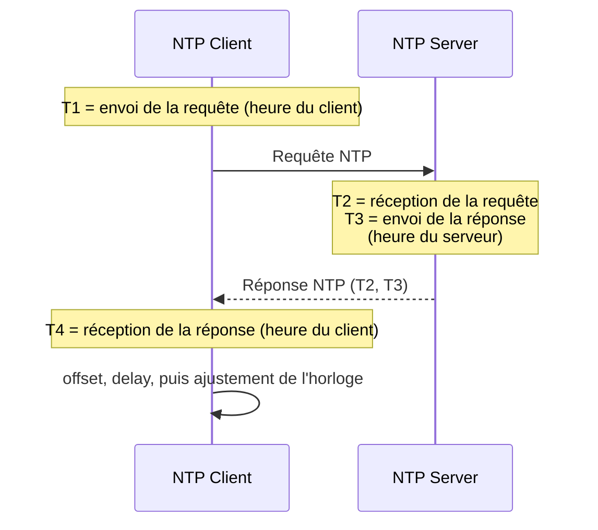

# NTP (Network Time Protocol) et son implication dans un réseau distribué

> **Fallacy :** « à tout endroit du réseau, chacun connaît l'heure avec précision » ([les 8 fallacies](fallacies.md)).  
> **À retenir :** des horloges réelles dérivent et se contredisent. NTP les rapproche (≈ ms), il ne les rend jamais identiques. Si seul l'**ordre** compte, on peut se passer de l'heure : horloges logiques.

Sans heure cohérente entre les nœuds, on ne sait plus dans quel ordre les événements ont eu lieu : un événement futur semble s'être produit avant un événement passé (base de données distribuée, transactions, journaux à corréler…).


## Mettre les horloges à l'heure : NTP

NTP synchronise les horloges de machines en réseau sur des **serveurs de temps** fiables, en ajustant progressivement l'horloge locale. Il prend en compte la latence du réseau et sa variabilité. Les serveurs sont organisés en **strates** : stratum 0 = source primaire (horloge atomique, GPS), stratum 1 = serveurs reliés directement à une source, stratum 2 = clients de stratum 1, etc. Précision typique : **la milliseconde**.

### PTP (Precision Time Protocol)

Pour la microseconde ou mieux (télécoms, trading haute fréquence, automatisation industrielle, audio/vidéo synchronisés), il faut **PTP** : réseau local contrôlé, support matériel (horloges matérielles dans les cartes et commutateurs), hiérarchie *grandmaster* → *slaves*.

| | **NTP** | **PTP** |
|---|---|---|
| Précision | millisecondes | microsecondes à nanosecondes |
| Conception | réseau global, grande échelle | réseau local, haute précision |
| Délais réseau | tolère des retards imprévisibles | suppose un réseau local contrôlé |
| Matériel | logiciel | support matériel nécessaire |
| Usage | serveurs, bases de données, logs | systèmes critiques |

Si la milliseconde suffit : NTP (simple, répandu). Sinon PTP.

## NTP en pratique

Échange entre un client et un serveur ([PDF si le diagramme ne s'affiche pas](ntp.pdf)) :



| Horodatage | Événement | Horloge |
|---|---|---|
| T1 | le client envoie la requête | client |
| T2 | le serveur reçoit la requête | serveur |
| T3 | le serveur envoie la réponse | serveur |
| T4 | le client reçoit la réponse | client |

- **Offset** (décalage de l'horloge du client) : `((T2 − T1) + (T3 − T4)) / 2`. Positif : le client est en retard.
- **Delay** (temps passé sur le réseau, aller-retour) : `(T4 − T1) − (T3 − T2)`. On retire le temps de traitement du serveur.

L'offset suppose que l'aller et le retour durent autant. Le *delay* ne corrige pas l'horloge : il mesure la **confiance** que l'on peut avoir dans l'offset. Plus il est grand, plus l'erreur possible (jusqu'à `delay / 2`) l'est aussi, et un client NTP peut ignorer ou retarder une correction faite dans de mauvaises conditions.

**Exemple.** `T2 − T1 = +5 ms` (le serveur semble 5 ms en avance à l'aller), `T3 − T4 = −3 ms` (au retour, 3 ms en retard) : offset = (5 − 3) / 2 = **+1 ms**.  
Autre exemple chiffré : voir [D02](../activites/drills/D02-temps.md) (décalage de 4 s, délai de 0,102 s).

**Astuce de calcul.** Convertir toutes les dates en *timestamps* (millisecondes depuis l'époque Unix, 1er janvier 1970 UTC) : plus de fuseaux, de formats ou d'unités à jongler. Transmettre et stocker en UTC, ne convertir qu'à l'affichage.

## Alternative logique

Si l'heure exacte n'est pas nécessaire mais que l'**ordre** compte, on utilise des **horloges logiques**.

### Algorithme de Lamport

Chaque nœud tient un compteur entier :

1. à chaque événement local et à chaque **envoi**, il l'incrémente et estampille le message ;
2. à chaque **réception**, il prend `max(compteur local, estampille reçue) + 1`.

Conséquence : si un message en a provoqué un autre, le premier a une estampille plus petite (**ordre causal**). En revanche, deux événements sans lien peuvent être ordonnés arbitrairement, et l'estampille ne dit rien de l'heure réelle. On l'utilise pour ordonner (chat, journal d'événements), jamais pour facturer ou fixer des horaires.

NTP réduit les écarts d'horloge ; Lamport garantit un ordre cohérent malgré eux. Les deux se complètent. Exercice : [D02](../activites/drills/D02-temps.md).

## Conclusion : prévoir le temps dès la conception

La notion de temps demande de maîtriser son concept logique et ses détails techniques (fuseaux, secondes intercalaires, dérive). Le code dépendant de l'heure est difficile à tester : **injectez l'horloge** plutôt que de lire l'heure système partout.

```
programme(horloge)          # l'horloge est un paramètre
    maintenant = horloge.instant_actuel()
    si maintenant < 1er janvier 2024 : "avant"  sinon : "après"

production : programme(horloge_système)
test       : programme(horloge_factice(31 déc. 2023, 23h59))
             horloge_factice.avancer(2 minutes)  →  le comportement change
```

On teste ainsi des dates et des délais sans attendre et sans modifier le code de production. Des bibliothèques existent pour la plupart des langages : [Joda-Time](https://www.joda.org/joda-time/quickstart.html) (Java), [NodaTime](https://nodatime.org/3.2.x/userguide/rationale) (C#, avec `FakeClock`).


