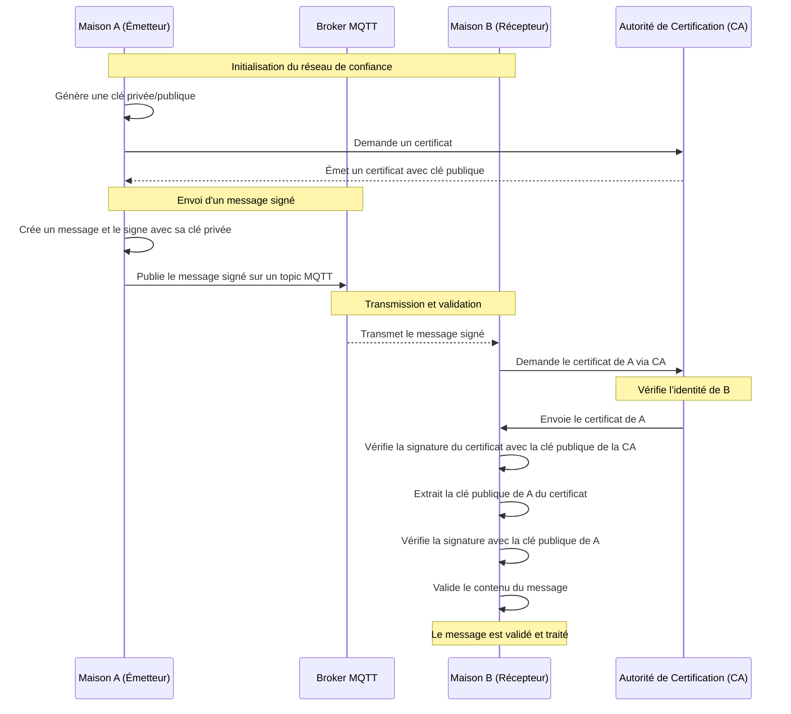

# Réseau de confiance

> **Fallacies :** 4 (le réseau est sûr), 6 (plusieurs administrateurs).  
> **À retenir :** deux questions distinctes. **Identité** : qui est-ce vraiment ? **Validité** : fait-il ce qu'il a le droit de faire ? Une signature répond à la première, pas à la seconde.

Un **réseau de confiance** est un modèle où chaque participant (maison connectée, appareil IoT…) accorde sa confiance aux autres par des relations directes ou indirectes. Cette confiance est essentielle à la validité des échanges.

## 2 aspects fondamentaux

### Identité

Chaque nœud doit être identifiable, des deux points de vue :

- le récepteur est certain de l'identité de l'émetteur ;
- l'émetteur ne peut pas prétendre ne pas être à l'origine du message : c'est la **non-répudiation**, qui implique une architecture de type **PKI**.

Pour cela :

- des **certificats de confiance** : les nœuds possèdent des certificats émis par une autorité centrale ou décentralisée, chacun associant une identité à une clé publique ;
- la **propagation de la confiance** : relations directes (A connaît B) ou transitives (A fait confiance à B, qui fait confiance à C) ;
- une **validation mutuelle** avant de partager des informations.

### Validité

Même si l'identité d'un nœud est vérifiée cryptographiquement, le réseau doit s'assurer que ses actions **respectent les règles communes** : contrôle, traçabilité, éventuellement consensus distribué, pour détecter ou prévenir les comportements frauduleux.

**Importance du logging.** On peut analyser les journaux pour détecter des opérations illicites. En centralisant le logging dans un microservice et en **signant** les messages de log (avec la clé privée de l'émetteur), on assure leur non-répudiation. Un outil d'analyse vérifie ensuite les opérations effectuées.

## Exemple d'application avec PKI (Public Key Infrastructure)

1. **Établissement de la confiance.** Chaque maison s'enregistre auprès d'une autorité de certification (CA) et obtient un certificat X.509 contenant sa clé publique. Les autres maisons valident ce certificat avant d'échanger.
2. **Signature des messages MQTT.** Les messages publiés via le broker sont **signés** avec la clé privée de l'émetteur (exemple : un message sur le topic `powercher`, accompagné de la signature de son contenu).
3. **Vérification.** Les abonnés utilisent la clé publique de l'émetteur (dans son certificat) pour s'assurer que le message **provient bien de l'émetteur déclaré** et que les **données n'ont pas été modifiées**.
4. **Fichiers volumineux.** On hache le fichier (par exemple SHA-256) avant transmission et on signe le hash.

### Diagramme de séquence

### Défis et solutions de la version PKI

| Défi | Problème | Piste |
|---|---|---|
| **Gestion des certificats** | distribution et **révocation** | vérifier l'état par un protocole comme [**OCSP**](https://www.fortinet.com/fr/resources/cyberglossary/ocsp) |
| **Latence et surcoût** | les opérations cryptographiques ajoutent de la latence | algorithmes plus légers (ECDSA plutôt que RSA), matériel dédié (puces TPM) |
| **Confiance initiale** | établir un réseau de confiance sans point central fort | modèle hybride avec une autorité initiale décentralisée, ou une blockchain |

## Dans ce module

Il n'y a pas d'autorité de certification officielle : la classe doit **décider ensemble** qui atteste de l'identité de qui (l'annuaire ? l'enseignant ? un accord de la classe ?) et ce qui se passe quand une clé fuit. C'est exactement le problème de la confiance initiale. Voir [C7](../activites/chat/C7-confiance.md) et [D09](../activites/drills/D09-securite.md).
