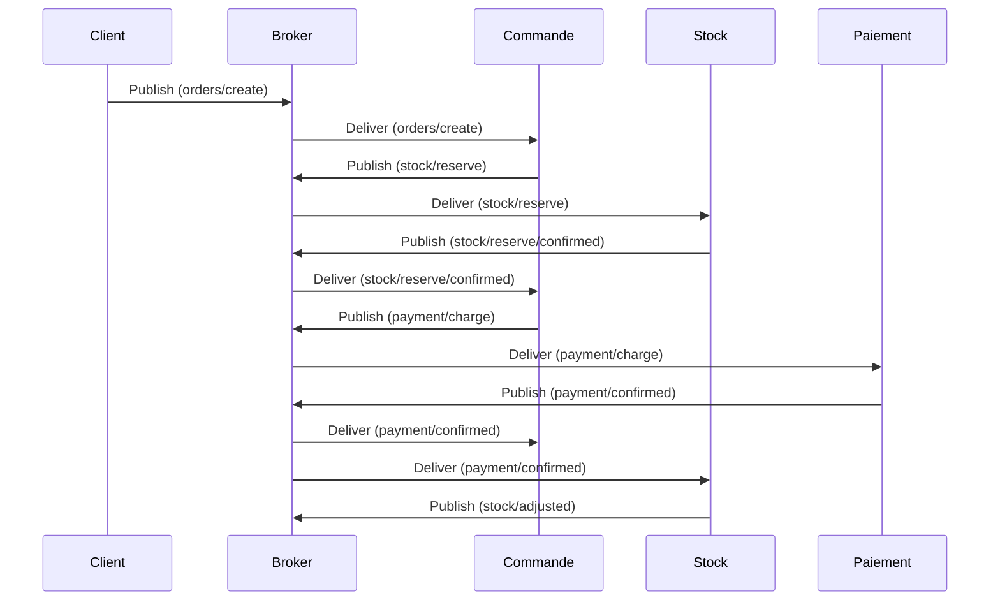

# Transactions

> **Fallacies :** 1 (fiabilité), 6 (plusieurs administrateurs).  
> **À retenir :** entre deux services indépendants on ne peut pas avoir d'atomicité « gratuite ». On obtient la cohérence **à terme** par des étapes **idempotentes** et des **compensations**. Le pire n'est pas l'échec, c'est le **résultat inconnu** (« a-t-il payé ou pas ? »).

Les transactions garantissent la **consistance** des données entre services. Elles sont **étroitement liées à [l'idempotence](idempotence.md)** : toutes deux visent à exécuter les opérations de façon fiable et cohérente malgré les défaillances.

## Qu'est-ce qu'une transaction ?

Une unité logique de travail composée d'une ou plusieurs opérations, selon les propriétés **ACID** :

1. **Atomicité** : tout réussit ou tout échoue, jamais de résultat partiel.
2. **Cohérence** : l'état du système reste valide avant et après.
3. **Isolation** : les modifications ne sont pas visibles par d'autres transactions avant validation (*commit*).
4. **Durabilité** : une fois validée, l'effet est permanent, même en cas de panne.

En architecture distribuée, plusieurs systèmes sont impliqués : c'est déjà difficile entre deux interlocuteurs (un client et un broker), et plus encore entre plusieurs microservices.

## Transactions distribuées

Exemple de commande : (1) le client passe commande, (2) le stock est mis à jour, (3) le paiement est validé. Si une sous-opération échoue, toutes les autres doivent être annulées (*rollback*).

Il faut un **coordinateur**, souvent selon le **Two-Phase Commit (2PC)** : tous les participants confirment qu'ils *peuvent* valider, puis le coordinateur ordonne la validation.

Inconvénients : **complexité** (blocages possibles), **latence** (échanges entre systèmes), **faible résilience** (si le coordinateur tombe, la transaction reste bloquée). Approprié quand la cohérence forte est indispensable.

### Exemple en trois étapes avec MQTT

Création d'une commande (scénario optimiste) : commande (`orders/create`), réservation du stock (`stock/reserve`), paiement (`payment/charge`). Si une étape échoue, les précédentes doivent être compensées.

## Transactions compensatoires (Sagas)

Plutôt qu'une transaction ACID complexe, on utilise des **sagas** (le terme désigne une transaction « longue ») : chaque étape peut être **compensée** par une action inverse en cas d'échec.

Exemple : (1) créer la commande, (2) sortir du stock, (3) débiter le client. Si l'étape 3 échoue, on **compense** : remettre dans le stock, supprimer la commande.

| | Avantages | Inconvénients |
|---|---|---|
| **Sagas** | résilience (pas de coordinateur central), scalabilité (chaque service gère ses compensations), plus simple à implémenter | chaque étape doit définir sa compensation ; les **états intermédiaires sont visibles** avant la fin |

Bien adaptées aux microservices et à MQTT : chaque service publie des messages pour confirmer ou annuler une étape.

## Rôle de l'idempotence

En cas de retransmission ou de reprise après échec, chaque étape doit pouvoir être **répétée sans effet indésirable**. Si une requête de débit est envoyée deux fois, le service de paiement doit reconnaître qu'il s'agit de la même transaction et éviter un double débit.

- **Identifiants uniques** : chaque étape porte un identifiant, qui permet de détecter et d'ignorer les doublons.
- **Stockage des états** : les services enregistrent les transactions déjà traitées.

Le cas le plus vicieux : le service a exécuté l'opération puis plante **avant de répondre**. L'appelant ne sait pas si elle a eu lieu. La seule réponse sûre : **renvoyer la même requête avec le même identifiant** (le service idempotent retourne le résultat de la première exécution). Voir [D06](../activites/drills/D06-transaction.md).

## Comparaison des modèles

| Modèle | Principe | Convient à |
|---|---|---|
| Centralisé (ACID) | une transaction globale, un *transaction manager* | systèmes monolithiques ou peu distribués |
| Distribué (2PC) | coordination par un protocole commun | cohérence forte nécessaire |
| Saga | étapes indépendantes + compensations | microservices, systèmes asynchrones |

## Recommandations

1. **Chaque étape idempotente**, identifiée par un identifiant unique.
2. **Privilégier les sagas** dans les architectures distribuées modernes : compromis entre simplicité et cohérence.
3. **Suivre les états intermédiaires** (journal ou base de données) : une transaction `en cours`, `payée` ou `annulée` doit être visible.
4. **Outils** : *Outbox pattern* (garantir la livraison des messages en cas de panne), middleware transactionnel (encapsule la transaction et gère les échecs).

En combinant **idempotence** et **transactions compensatoires**, on conçoit des systèmes distribués robustes qui garantissent cohérence et résilience face aux défaillances.

## Pour s'exercer

- Drill : [D06](../activites/drills/D06-transaction.md) · Activité : [Transat](../activites/transat/README.md)
